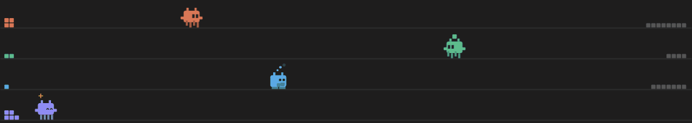
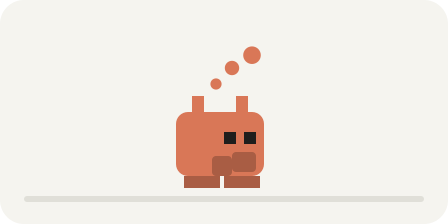
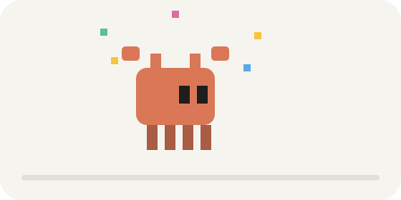
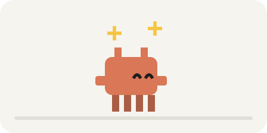
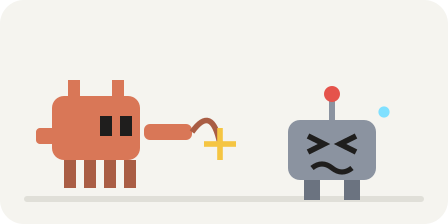
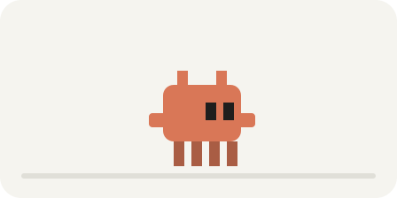

# Pet-claudinho

Mod do Claude Code: um mini Claude que fica acima do prompt e representa os agentes.



Cada agente (o principal e os subagentes) ganha uma trilha e uma cor própria. O bichinho:

- anda e carrega blocos até o montinho conforme as tarefas avançam;
- pensa quando chega raciocínio e dorme (zzz) quando o agente fica parado;
- tropeça quando uma ferramenta dá erro e espera quando pede permissão;
- comemora no fim do pedido, contempla o montinho pronto e se despede quando um subagente termina;
- chicoteia o robô de outra IA, quando outra IA está em ação.

## Situações

Cada agente tem uma destas situações a cada momento.

| | Situação | O que significa |
| --- | --- | --- |
|  | **Andando** | Entregando uma tarefa concluída. |
|  | **Minerando** | Executando uma tarefa. |
|  | **Pensando** | Raciocinando ou lendo arquivos. |
|  | **Esperando permissão** | Aguardando você aprovar uma ação. |
|  | **Tropeçando** | Uma ferramenta deu erro. |
|  | **Comemorando** | O pedido terminou. |
|  | **Contemplando** | Todas as tarefas concluídas. |
|  | **Despedindo** | Um subagente terminou. |
|  | **Chicoteando outra IA** | Usando outra IA (codex, gemini, ollama...). |
|  | **Dormindo** | Sem atividade há 20 s. |
|  | **Parado** | Ocioso, esperando o próximo pedido. |

As imagens são animadas e ficam em `docs/estados/`. São geradas por `python3 docs/gerar_estados.py`, que reproduz os quadros e o ritmo do desenho do `hooks/register.tsx`.

## Instalação

```bash
git clone https://github.com/TraspJorge/Pet-claudinho.git
claude plugin marketplace add ./Pet-claudinho
claude plugin install claudinho@claudinho-local
```

Abra uma sessão nova do Claude Code depois de instalar.

## Comando `/claudinho`

| Uso | Efeito |
| --- | --- |
| `/claudinho` | Esconde ou mostra os bichinhos |
| `/claudinho zerar` | Recomeça os montinhos |
| `/claudinho demo` | Demonstração de 45 s com 4 agentes de mentira, sem custo |
| `/claudinho cor azul` | Muda a cor do principal: laranja, verde, azul, roxo, rosa ou amarelo (`cor padrão` volta ao laranja) |

O comando não aparece na lista de comandos, mas funciona se digitado inteiro.

## Desenvolvimento

```bash
claude plugin validate .
```

O estado compartilhado entre os ganchos está descrito em `types/index.d.ts`.
